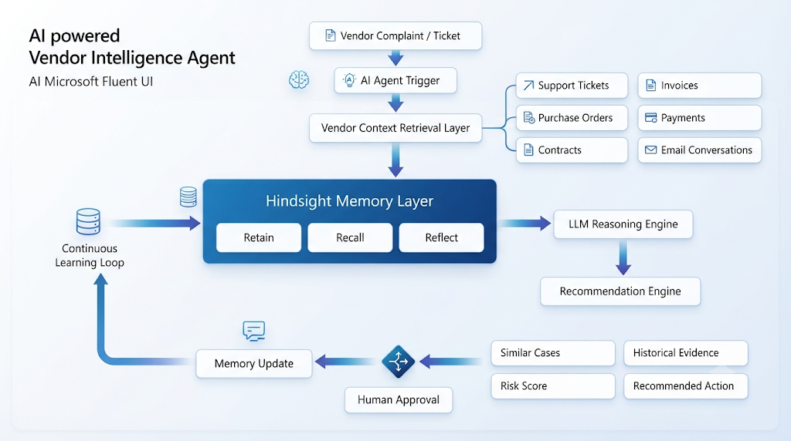
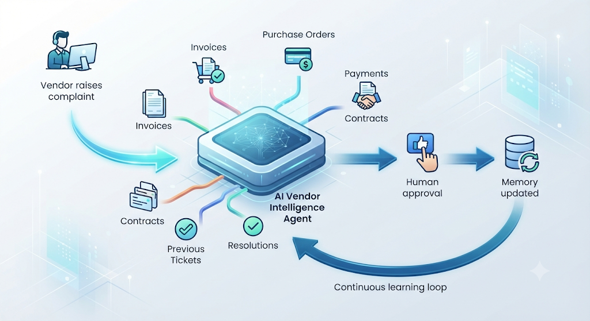
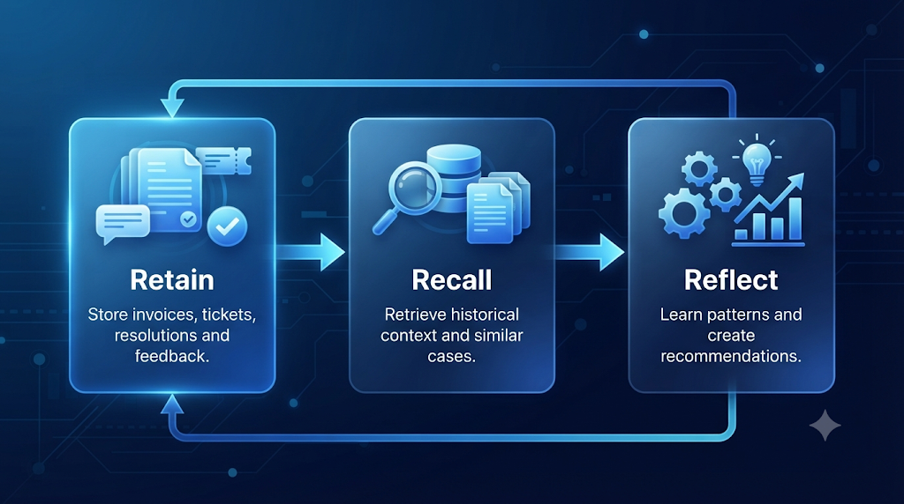
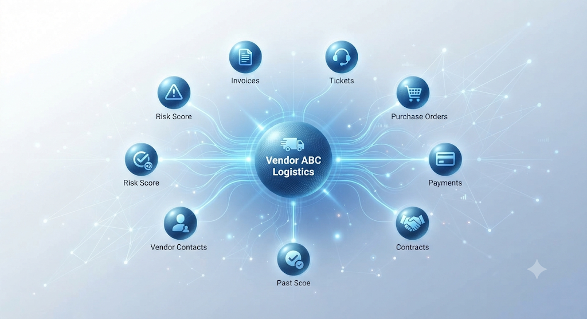

<div align="center">

# Vendor Intelligence Agent

**An AI agent with long-term memory for finance & support teams**

[]()
[]()
[]()

[Overview](#overview) · [The Problem](#the-problem) · [What It Remembers](#what-it-remembers) · [How It Works](#how-it-works) · [Example](#example) · [images](#images) · [Feedback](#open-questions)

</div>

---

## Overview

A **Vendor Intelligence Agent** powered by long-term memory, built as a hackathon project to explore how AI agents can support enterprise finance and customer support operations.

> The interesting part is not the chatbot itself, but the **memory layer** that helps the agent improve over time.

---

## The Problem

Today, when a vendor raises a complaint such as:

- *"Why is my payment delayed?"*
- *"Why was my invoice rejected?"*
- *"Why was my PO not approved?"*

Employees often have to manually search through **tickets, invoices, emails, payment records, purchase orders, and previous resolutions**.

A lot of the context exists **only in senior employees' heads**.

---

## What It Remembers

The agent stores and recalls a vendor's full working history:

| Memory | Why it matters |
| --- | --- |
| 🏢 **Vendor history** | Who the vendor is and how the relationship has evolved |
| 🎫 **Previous tickets** | What was raised before, and how often |
| 🧾 **Invoices** | What was billed, disputed, or rejected |
| 📦 **Purchase orders** | What was authorized and on what terms |
| 💸 **Payment records** | What was paid, delayed, or still pending |
| ✅ **Past resolutions** | What actually fixed the issue last time |
| 🧑‍💼 **Human feedback** | Corrections and approvals from the team |

---

## How It Works

When a new ticket arrives, the agent:

1. **Recalls** similar historical cases
2. **Explains** what happened previously
3. **Suggests** a resolution
4. **Shows the evidence** behind the recommendation

Over time, it **learns recurring vendor patterns** and **proposes rules** — while still keeping **humans in the approval loop**.

```text
 Vendor complaint
        │
        ▼
 ┌──────────────────┐
 │  Memory layer    │  vendor history · tickets · invoices
 │  (recall)        │  POs · payments · resolutions · feedback
 └────────┬─────────┘
          │  similar past cases + evidence
          ▼
 ┌──────────────────┐
 │  Reasoning       │  what happened before
 │                  │  recommended next action
 └────────┬─────────┘
          │
          ▼
 ┌──────────────────┐
 │  Human review    │  approve · correct · give feedback
 └──────────────────┘
          │
          └──► learns patterns → proposes rules
```

---

## Example

**Vendor:**

> Why is my payment delayed?

**Agent:**

> Four similar cases were found. In previous disputes, payment was delayed because freight charges were already included in the PO.
>
> **Recommended action:** verify the current PO and escalate to AP manager.

---

## images

<div align="center">

| | |
| :-: | :-: |
|  |  |
|  |  |

*Vendor Intelligence Agent — project visuals.*

</div>

---

## Open Questions

This is an early concept, and feedback is very welcome:

1. **Would this be useful in real organizations?**
2. **What information would you expect the agent to remember?**
3. **What would make you trust (or not trust) its recommendations?**
4. **Have you seen similar systems being used successfully?**

---

## Tags

`#AI` `#AIAgents` `#MachineLearning` `#EnterpriseAI` `#Hindsight` `#Startups` `#SaaS` `#FinanceTech` `#CustomerSupport` `#Automation`


